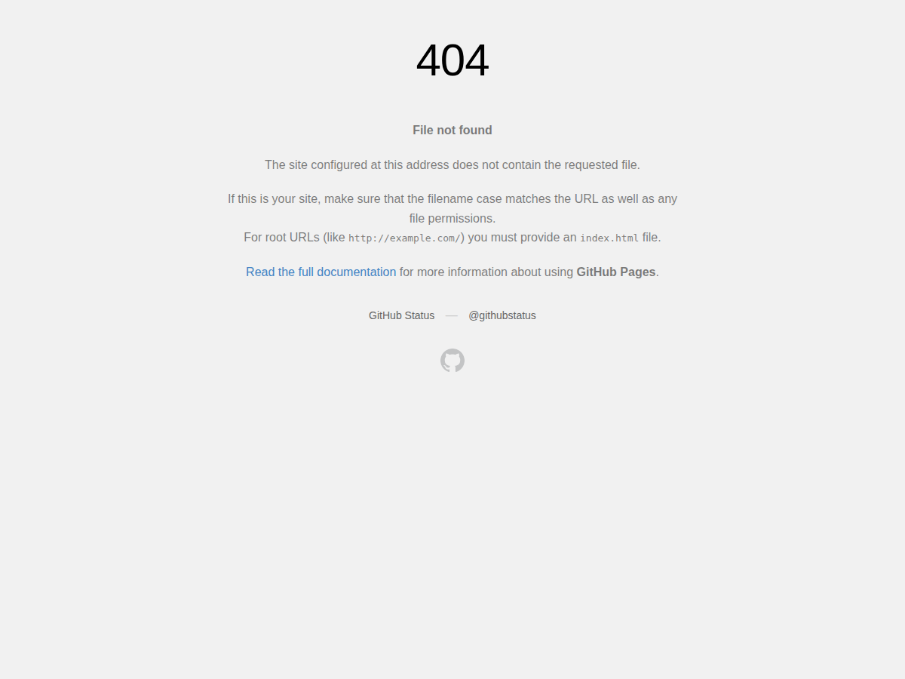

# Seance

<!-- shot:start -->



<!-- shot:end -->

[](https://drsamonline.github.io/seance/)
[](LICENSE)
[ and **web-kit**.

## What it does

- **Seal:** a note + a passphrase → a sealed text (base64) you can paste anywhere.
- **Open:** paste the sealed text + the passphrase → the note.
- Authenticated encryption, so a wrong passphrase or altered text is rejected.
- Share the text and the passphrase **separately** — the text is useless alone.
- Everything happens on your device; nothing is sent anywhere.

## Run it

Open `docs/index.html`. That's the whole app — offline, from `file://` or Pages.
(It needs a **secure context** for Web Crypto: Pages is https, so the live site is
fine; some browsers restrict `file://`.)

## Structure

```
docs/index.html      the app
docs/web-kit.js      the shared runtime (drsamonline/web-kit)
docs/crypto-kit.js   the crypto core   (drsamonline/crypto-kit)
```

## Honest limits

- A passphrase-sealed note is only as strong as the passphrase. Use a strong one.
- "Opened once" is remembered **on this device** — it is a courtesy, not
  enforcement; a determined reader can clear storage or open it elsewhere.
- Not a substitute for a vetted messaging app for anything truly sensitive.

## Licence

MIT. (c) 2026 Dr Sohil Momin.
