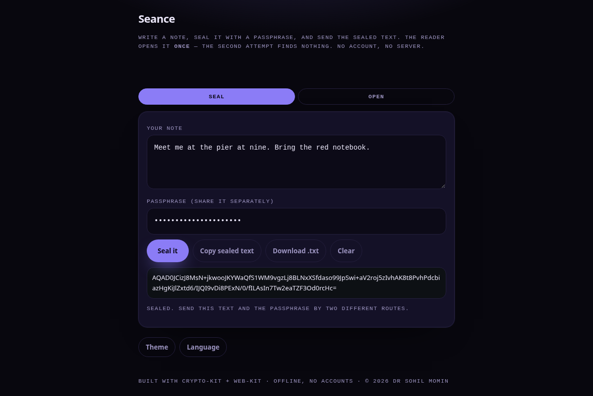

# Seance

<!-- shot:start -->



<!-- shot:end -->

[](https://drsamonline.github.io/seance/)
[](LICENSE)
[. The reader opens
it once on their own device — offline, no account — and the second attempt finds nothing.

Built with **crypto-kit** (AES-256-GCM) and **web-kit**.

## What it does

- **Seal:** a note + a passphrase → a sealed text (base64) you can paste anywhere.
- **Open:** paste the sealed text, or open the `.txt` you were sent, + the passphrase → the note.
- Authenticated encryption, so a wrong passphrase or altered text is rejected.
- Share the text and the passphrase **separately** — the text is useless alone.
- Everything happens on your device; nothing is sent anywhere.

## Run it

Open `docs/index.html`. That's the whole app — offline, from `file://` or Pages.
(It needs a **secure context** for Web Crypto: Pages is https, so the live site is
fine; some browsers restrict `file://`.)

## Structure

```
docs/index.html      the app
docs/web-kit.js      the shared runtime (drsamonline/web-kit)
```

## Honest limits

- A passphrase-sealed note is only as strong as the passphrase. Use a strong one.
- "Opened once" is remembered **on this device** — it is a courtesy, not
  enforcement; a determined reader can clear storage or open it elsewhere.
- Not a substitute for a vetted messaging app for anything truly sensitive.

<!-- support:sweep -->
## Support

| | |
|---|---|
| UPI (India) | `drsohilboi@ybl` — payee Dr Sohil Momin, open amount, or scan [the QR](docs/assets/upi-qr.svg) |
| GitHub Sponsors | [github.com/sponsors/drsamonline](https://github.com/sponsors/drsamonline) |
| Ko-fi | [ko-fi.com/matneo](https://ko-fi.com/matneo) |
| PayPal | [paypal.me/drsohilmomin](https://paypal.me/drsohilmomin?locale.x=en_GB&country.x=IN) |
| My books | [Amazon author store](https://www.amazon.com/stores/author/B08ZT331LY/allbooks?ccs_id=aed72b9f-71d9-41dc-adee-e9368a317acc) |
| More apps | [drsamonline.github.io](https://drsamonline.github.io/) |
| Email | [sohilmomin2000@gmail.com](mailto:sohilmomin2000@gmail.com) |

## Licence

MIT. (c) 2026 Dr Sohil Momin.
